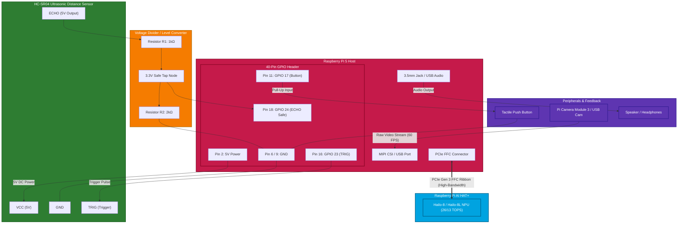

# Real-Time Edge AI Object Detection & Assistive Vision

An ultra-low-latency, real-time object detection and smart vision assistant engineered for **Raspberry Pi 5** paired with the **Raspberry Pi AI HAT+ (Hailo-8 / Hailo-8L Dedicated NPU)**.

---

## 🚀 Key Features

* **Hailo-8 NPU Hardware Acceleration**: Offloads complex YOLOv8 deep learning matrix multiplications to the dedicated 26 TOPS / 13 TOPS NPU via PCIe Gen 3.
* **60 FPS Real-Time Performance**: Processes full-rate camera streams without the frame drops or latency spikes typical of CPU-only execution.
* **Low CPU Utilization (<15%)**: Keeps the Raspberry Pi 5 Broadcom CPU free for networking, sensor polling, and audio, preventing thermal throttling (stays well below 85°C).
* **80 COCO Classes with Spatial Awareness**: Detects everyday objects and calculates their spatial orientation (*"on your left"*, *"straight ahead"*, *"on your right"*).
* **Proximity & Manual Triggers**:
  * HC-SR04 ultrasonic sensor continuously monitors for obstacles closer than 1.0 meter.
  * Tactile push button enables on-demand voice queries.
* **Non-Blocking Text-to-Speech**: Integrated `espeak` engine provides instant spoken audio alerts without interrupting the video stream.
* **Hardware Benchmark Tool**: Built-in script to measure FPS, per-frame latency, CPU load %, and SoC temperature.

---

## 📊 Architecture Specification

| Metric | With Hailo-8 AI HAT+ (Dedicated NPU) | CPU-Only Baseline |
|---|---|---|
| **Frame Rate** | **60 FPS (Flawless, Real-Time)** | ~3 FPS (Choppy slideshow) |
| **CPU Utilization** | **< 15% (Pi runs cool)** | ~100% (Severe strain) |
| **Thermal State** | Stable, cool | Severe thermal throttling (85°C+) |
| **Model** | YOLOv8n / YOLOv8s (80 COCO classes) | Obsolete MobileNet-SSD |

---

## 🔌 Hardware Connections & Wiring Graph

The system pairs the Raspberry Pi 5 with the Hailo-8 AI HAT+ via the high-speed PCIe connector, while integrating the HC-SR04 ultrasonic sensor, tactile push button, camera, and speaker via the 40-pin GPIO header and peripheral buses.

### Hardware Connection Graph



---

### Detailed Pinout & Wiring Table

| Raspberry Pi 5 Pin | Header Label | Connects To | Wire / Role | Notes |
|---|---|---|---|---|
| **Pin 2** | `5V Power` | HC-SR04 `VCC` | Power (Red) | Supplies 5V required by HC-SR04 |
| **Pin 6 / 9** | `GND` | HC-SR04 `GND`, Button Pin 2, Divider `GND` | Ground (Black) | Common ground reference |
| **Pin 16** | `GPIO 23` | HC-SR04 `TRIG` | Signal (Yellow/Orange) | Sends $10\mu\text{s}$ ultrasonic pulse |
| **Pin 18** | `GPIO 24` | Center node of Voltage Divider ($1\text{k}\Omega / 2\text{k}\Omega$) | Signal (Green) | Stepped-down 3.3V safe Echo input |
| **Pin 11** | `GPIO 17` | Push Button Terminal 1 | Signal (Blue) | Internal pull-up enabled in software |
| **PCIe FFC** | `PCIe 1-lane` | Raspberry Pi AI HAT+ | 16-pin Ribbon | High-speed PCIe Gen 3 bus to Hailo-8 |
| **CSI / USB** | `CAM / USB 3.0`| Camera Module 3 or USB 60 FPS Webcam | Video In | Up to 60 FPS video capture |
| **3.5mm / USB**| `Audio Jack` | Mini Speaker / Amplified 3.5mm Speaker | Audio Out | Spoken voice alerts via `espeak` |

> [!CAUTION]
> **Protecting Raspberry Pi 5 3.3V GPIO Pins**:
> The HC-SR04 sensor outputs a **5V pulse** on its `ECHO` pin. Connecting this directly to the Pi's GPIO 24 can damage the processor's GPIO bank.
> Always use a **voltage divider** or level converter:
>
> $$V_{\text{out}} = V_{\text{in}} \times \left(\frac{R_2}{R_1 + R_2}\right) = 5\text{V} \times \left(\frac{2000\,\Omega}{1000\,\Omega + 2000\,\Omega}\right) = 3.33\text{V}$$
>
> * Connect `ECHO` $\rightarrow$ $1\text{k}\Omega$ resistor ($R_1$).
> * Connect the other end of $R_1$ to `GPIO 24` and to a $2\text{k}\Omega$ resistor ($R_2$).
> * Connect the other end of $R_2$ to `GND`.

---

## 🔄 End-to-End System Workflow

The architecture decouples the camera stream, hardware sensor polling, deep learning inference, and audio output into dedicated, non-blocking pathways.

```mermaid
flowchart TD
    subgraph Initialization ["1. System Boot & Initialization"]
        INIT_START([System Start]) --> PCIE_INIT[Initialize PCIe Gen 3 Link]
        PCIE_INIT --> HAILO_INIT[Configure HailoRT VDevice & Load YOLOv8 HEF]
        HAILO_INIT --> CAM_INIT[Start HighSpeedCameraStream Background Thread]
        CAM_INIT --> GPIO_INIT[Initialize GPIO: DistanceSensor & Button]
        GPIO_INIT --> READY_VOICE[Speak: 'Hailo AI system ready']
    end

    subgraph Streaming ["2. Continuous 60 FPS Video Pipeline"]
        CAM_INIT -.-> CAM_LOOP[Threaded Camera Capture Loop]
        CAM_LOOP -->|Read Frame @ 60 FPS| BUFFER[Thread-Safe Frame Buffer]
        BUFFER -.->|Latest Live Frame| NPU_INFER
    end

    subgraph Polling ["3. Sensor Polling Loop (Every 100ms)"]
        READY_VOICE --> LOOP_START[Poll Distance & Button State]
        LOOP_START --> READ_SENSORS[Read get_distance and is_button_pressed]
        READ_SENSORS --> TRIGGER_CHECK{Trigger Condition Met?<br/>Distance < 1.0m OR Button Pressed<br/>AND Cooldown > 3.0s?}
    end

    TRIGGER_CHECK -- No --> LOOP_START

    subgraph AI_Inference ["4. Hailo-8 NPU Object Detection"]
        TRIGGER_CHECK -- Yes --> GRAB_FRAME[Fetch Freshest Frame from Buffer]
        GRAB_FRAME --> RESIZE[Resize to 640x640 RGB]
        RESIZE --> NPU_INFER[Offload to Hailo-8 NPU via InferVStreams]
        NPU_INFER --> NMS[Hailo On-Chip NMS & Class Parsing]
        NMS --> FILTER_CONF{Any Detection > 50% Confidence?}
    end

    subgraph Audio_Feedback ["5. Spatial Awareness & Voice Output"]
        FILTER_CONF -- Yes --> CALC_DIR[Calculate Spatial Direction:<br/>Left / Straight Ahead / Right]
        CALC_DIR --> FORMAT_ALERT[Format Speech: '[Object] detected [Direction] at [Distance]m']
        FILTER_CONF -- No --> FORMAT_GENERIC[Format Speech: 'Obstacle ahead, cannot identify object']
        FORMAT_ALERT --> SPEAK_ASYNC[Speak Asynchronously via espeak]
        FORMAT_GENERIC --> SPEAK_ASYNC
    end

    subgraph Telemetry ["6. Real-Time HUD Overlay & Display"]
        SPEAK_ASYNC --> OVERLAY[Render Bounding Boxes + Direction Labels]
        OVERLAY --> HUD[Display Live FPS, CPU Load %, and NPU Status]
        HUD --> RESET_TIMER[Reset 3.0s Cooldown Timer]
        RESET_TIMER --> LOOP_START
    end

    subgraph Teardown ["7. Safe Shutdown"]
        LOOP_START -.->|SIGINT / Ctrl+C| CLEANUP[Release Camera Stream]
        CLEANUP --> CLOSE_HAILO[Close Hailo VDevice]
        CLOSE_HAILO --> CLOSE_GPIO[Close GPIO Handles & Terminate TTS]
        CLOSE_GPIO --> EXIT([System Safely Halted])
    end

    classDef init fill:#1565c0,stroke:#0d47a1,stroke-width:2px,color:#fff;
    classDef stream fill:#00838f,stroke:#006064,stroke-width:2px,color:#fff;
    classDef poll fill:#ef6c00,stroke:#e65100,stroke-width:2px,color:#fff;
    classDef ai fill:#2e7d32,stroke:#1b5e20,stroke-width:2px,color:#fff;
    classDef voice fill:#6a1b9a,stroke:#4a148c,stroke-width:2px,color:#fff;
    classDef tele fill:#37474f,stroke:#263238,stroke-width:2px,color:#fff;
    classDef stop fill:#c62828,stroke:#b71c1c,stroke-width:2px,color:#fff;

    class Initialization,INIT_START,PCIE_INIT,HAILO_INIT,CAM_INIT,GPIO_INIT,READY_VOICE init;
    class Streaming,CAM_LOOP,BUFFER stream;
    class Polling,LOOP_START,READ_SENSORS,TRIGGER_CHECK poll;
    class AI_Inference,GRAB_FRAME,RESIZE,NPU_INFER,NMS,FILTER_CONF ai;
    class Audio_Feedback,CALC_DIR,FORMAT_ALERT,FORMAT_GENERIC,SPEAK_ASYNC voice;
    class Telemetry,OVERLAY,HUD,RESET_TIMER tele;
    class Teardown,CLEANUP,CLOSE_HAILO,CLOSE_GPIO,EXIT stop;
```

---

## ⚡ Installation & Quick Start

### 1. Enable PCIe Gen 3 on Raspberry Pi 5
Edit your Pi's boot configuration:
```bash
sudo nano /boot/firmware/config.txt
```
Append to the end of the file:
```ini
dtparam=pciex1
dtparam=pciex1_gen=3
```
Reboot the Pi:
```bash
sudo reboot
```

### 2. Install System Drivers & Dependencies
```bash
sudo apt update && sudo apt install hailo-all python3-opencv python3-gpiozero python3-psutil espeak -y
```

Verify that the NPU is active:
```bash
hailortcli fw-control identify
```

### 3. Install Python Dependencies
```bash
pip install -r requirements.txt --break-system-packages
```

### 4. Run the System

**Launch the Assistant (with live HUD):**
```bash
python3 smart_assistant.py
```

**Launch in Headless Mode (for battery / portable use):**
```bash
python3 smart_assistant.py --headless
```

**Run Performance Benchmark:**
```bash
python3 benchmark_performance.py
```

---

## 📁 Repository Structure

```text
├── smart_assistant.py          # Main real-time assistant application & telemetry HUD
├── hailo_detector.py           # Hailo-8 NPU YOLOv8 inference engine with CPU fallback
├── benchmark_performance.py    # Performance & thermal benchmarking tool
├── HAILO_SETUP_GUIDE.md        # Comprehensive Raspberry Pi 5 setup documentation
├── requirements.txt            # Python dependencies
├── README.md                   # Project documentation, wiring diagrams & workflow
└── .gitignore                  # Git ignore rules
```

---

## 📄 License
MIT License
