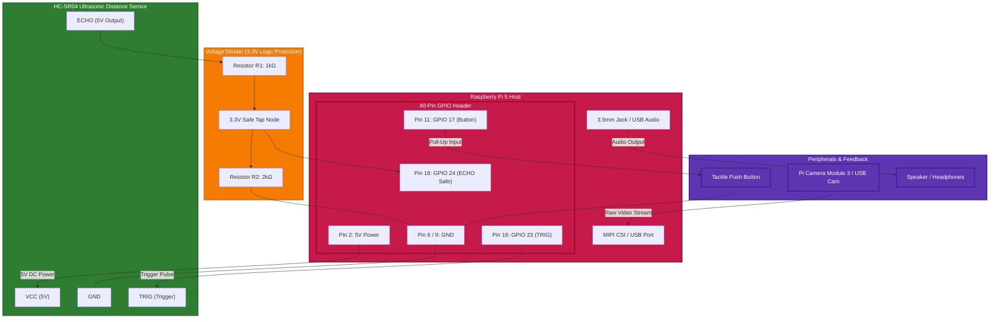
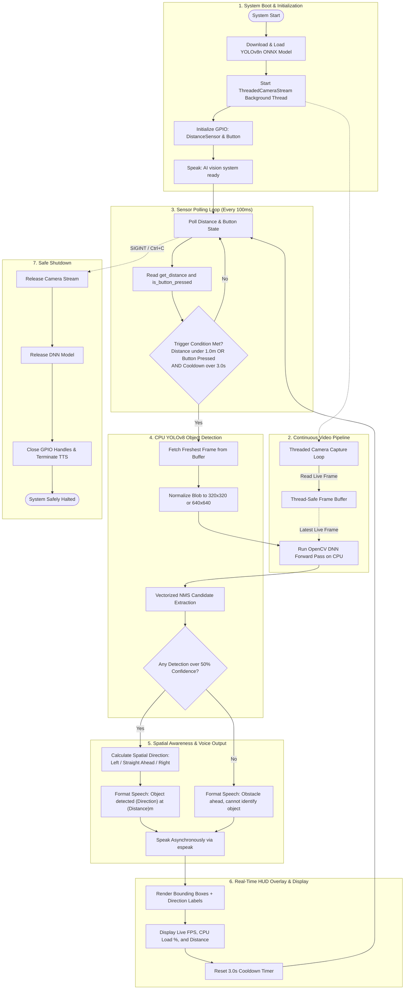

# Real-Time Edge AI Object Detection & Assistive Vision

A real-time object detection and smart vision assistant engineered for **Raspberry Pi 5** using a CPU-optimized **YOLOv8** architecture (no dedicated NPU or AI HAT required).

[](https://colab.research.google.com/github/rootnode-rebels/ai-object-detection/blob/main/Build_Assistive_92_Model.ipynb)

---

## 🚀 Key Features

* **CPU-Optimized YOLOv8 Inference**: Runs lightweight YOLOv8n ONNX via OpenCV DNN with ARM NEON acceleration, achieving ~15-20 FPS directly on the Raspberry Pi 5 CPU.
* **80 COCO Classes with Spatial Awareness**: Detects everyday objects and calculates their spatial position (*"on your left"*, *"straight ahead"*, *"on your right"*).
* **Buffer-Free High-Speed Video Pipeline**: Threaded camera stream eliminates OpenCV internal frame buffer delay, guaranteeing zero-latency live vision analysis.
* **Proximity & Manual Triggers**:
  * HC-SR04 ultrasonic sensor continuously monitors for obstacles closer than 1.0 meter.
  * Tactile push button enables instant on-demand voice queries.
* **Non-Blocking Text-to-Speech**: Integrated `espeak` engine speaks directional audio alerts asynchronously without freezing the video stream.
* **Real-Time Telemetry HUD**: Live onscreen overlay displaying current FPS, CPU load %, distance reading, and object bounding boxes.
* **Hardware Benchmark Tool**: Built-in benchmarking script to measure frame rates, latencies, CPU load, and SoC temperatures.

---

## 📊 System Specifications

| Component | Specification |
|---|---|
| **Host System** | Raspberry Pi 5 (Quad-core ARM Cortex-A76 @ 2.4 GHz) |
| **Deep Learning Model** | YOLOv8n ONNX (80 COCO object classes) |
| **Inference Engine** | OpenCV DNN (CPU Backend with ARM NEON SIMD) |
| **Resolution Modes** | `320x320` (~15-20 FPS fast mode) / `640x640` (high accuracy mode) |
| **Proximity Sensor** | HC-SR04 Ultrasonic Distance Sensor |
| **Manual Trigger** | Push button with internal pull-up |
| **Audio Feedback** | `espeak` Text-to-Speech Engine |

---

## 🔌 Hardware Connections & Wiring Graph

The setup connects the HC-SR04 ultrasonic sensor, tactile push button, camera, and speaker directly to the Raspberry Pi 5.

### Hardware Connection Graph



---

### Pinout & Wiring Table

| Raspberry Pi 5 Pin | Header Label | Connects To | Wire / Role | Notes |
|---|---|---|---|---|
| **Pin 2** | `5V Power` | HC-SR04 `VCC` | Power (Red) | Supplies 5V required by HC-SR04 |
| **Pin 6 / 9** | `GND` | HC-SR04 `GND`, Button Pin 2, Divider `GND` | Ground (Black) | Common ground reference |
| **Pin 16** | `GPIO 23` | HC-SR04 `TRIG` | Signal (Yellow/Orange) | Sends $10\mu\text{s}$ ultrasonic pulse |
| **Pin 18** | `GPIO 24` | Center node of Voltage Divider ($1\text{k}\Omega / 2\text{k}\Omega$) | Signal (Green) | Stepped-down 3.3V safe Echo input |
| **Pin 11** | `GPIO 17` | Push Button Terminal 1 | Signal (Blue) | Internal pull-up enabled in software |
| **CSI / USB** | `CAM / USB 3.0`| Camera Module 3 or USB Webcam | Video In | Live camera stream |
| **3.5mm / USB**| `Audio Jack` | Mini Speaker / Amplified Speaker | Audio Out | Spoken voice alerts via `espeak` |

> [!CAUTION]
> **Protecting Raspberry Pi 5 3.3V GPIO Pins**:
> The HC-SR04 sensor outputs a **5V pulse** on its `ECHO` pin. Connecting this directly to the Pi's GPIO 24 can damage the processor's GPIO bank.
> Always use a **voltage divider**:
>
> $$V_{\text{out}} = 5\text{V} \times \left(\frac{2000\,\Omega}{1000\,\Omega + 2000\,\Omega}\right) = 3.33\text{V}$$
>
> * Connect `ECHO` $\rightarrow$ $1\text{k}\Omega$ resistor ($R_1$).
> * Connect the other end of $R_1$ to `GPIO 24` and to a $2\text{k}\Omega$ resistor ($R_2$).
> * Connect the other end of $R_2$ to `GND`.

---

## 🔄 End-to-End System Workflow



---

## ⚡ Installation & Quick Start

### Option A: Local PC Simulation (Windows / Mac / Linux)
You can test the entire pipeline on your PC with your webcam, simulated distance sensor, and native voice synthesis:

1. **One-Click Run (Windows):**
   Simply double-click `run_pc_demo.bat`.

2. **Manual Command:**
   ```bash
   python simulate_pc.py --model model_files/yolov8_assistive_92.onnx --classes classes.txt --resolution 320
   ```
   *Controls during PC simulation:*
   * `[SPACE]` : Press virtual hardware tactile button (triggers on-demand query)
   * `[W]` / `[UP]` : Move closer to obstacle (decreases ultrasonic distance)
   * `[S]` / `[DOWN]` : Move farther from obstacle (increases ultrasonic distance)
   * `[A]` : Toggle Auto-walk radar oscillation mode
   * `[Q]` / `[ESC]` : Exit simulation

3. **Interactive Hardware Web Simulator:**
   Open `simulation.html` in any web browser to interactively test the ultrasonic radar, push button, HUD, and voice synthesis in a GUI environment.

---

### Option B: Physical Raspberry Pi 5 Deployment

#### 1. Install System Dependencies
On Raspberry Pi OS (Bookworm):
```bash
sudo apt update && sudo apt install python3-opencv python3-gpiozero python3-psutil python3-numpy espeak -y
```

#### 2. Install Python Packages
```bash
pip install -r requirements.txt --break-system-packages
```

#### 3. Run the Smart Assistant

**Standard 92-Class Assistive Mode (~15-20 FPS on Pi 5 CPU):**
```bash
python3 smart_assistant.py --model model_files/yolov8_assistive_92.onnx --classes classes.txt --resolution 320
```

**COCO-80 Baseline Mode:**
```bash
python3 smart_assistant.py --resolution 320
```

**Headless Mode (for battery-powered wearable use):**
```bash
python3 smart_assistant.py --headless
```

#### 4. Run Benchmark Tool
```bash
python3 benchmark_performance.py
```

---

## 🎯 92 Supported Assistive Classes

The custom-trained assistive model detects 92 essential indoor, outdoor, and hazard objects:

* **Pedestrian & Navigation Hazards**: `staircase`, `door`, `pothole`, `manhole`, `speed breaker`, `pedestrian crossing`, `road barrier`, `road divider`, `traffic cone`, `drain`, `fence`, `gate`, `construction material`, `rock`, `stone`
* **Vehicles & Street Mobility**: `person`, `auto-rickshaw`, `car`, `bus`, `truck`, `motorcycle`, `scooter`, `bicycle`, `street light`, `traffic light`, `fire hydrant`
* **Indoor Furniture & Landmarks**: `chair`, `bench`, `table`, `desk`, `bed`, `sofa`, `cabinet`, `cupboard`, `shelf`, `switchboard`, `electrical socket`, `sink`, `toilet`
* **Everyday Objects**: `water bottle`, `backpack`, `mobile phone`, `laptop`, `book`, `cup`, `glass`, `plate`, `bowl`, `spoon`, `fork`

---

## 📁 Repository Structure

```text
├── run_pc_demo.bat             # 1-Click Windows PC demo launcher
├── simulate_pc.py              # Native PC simulation & CV demo with speech
├── simulation.html             # Interactive browser-based hardware simulator
├── smart_assistant.py          # Main real-time Raspberry Pi 5 assistant & HUD
├── yolo_detector.py            # CPU-optimized YOLOv8 inference engine
├── build_assistive_model.py    # Zero-shot CLIP encoder for custom classes
├── classes.txt                 # List of 92 assistive object classes
├── benchmark_performance.py    # Performance & thermal benchmarking tool
├── SETUP_GUIDE.md              # Raspberry Pi 5 hardware wiring & setup guide
├── requirements.txt            # Python dependencies
├── README.md                   # Project documentation & wiring diagrams
└── .gitignore                  # Git ignore rules
```

---

## 📄 License
MIT License

